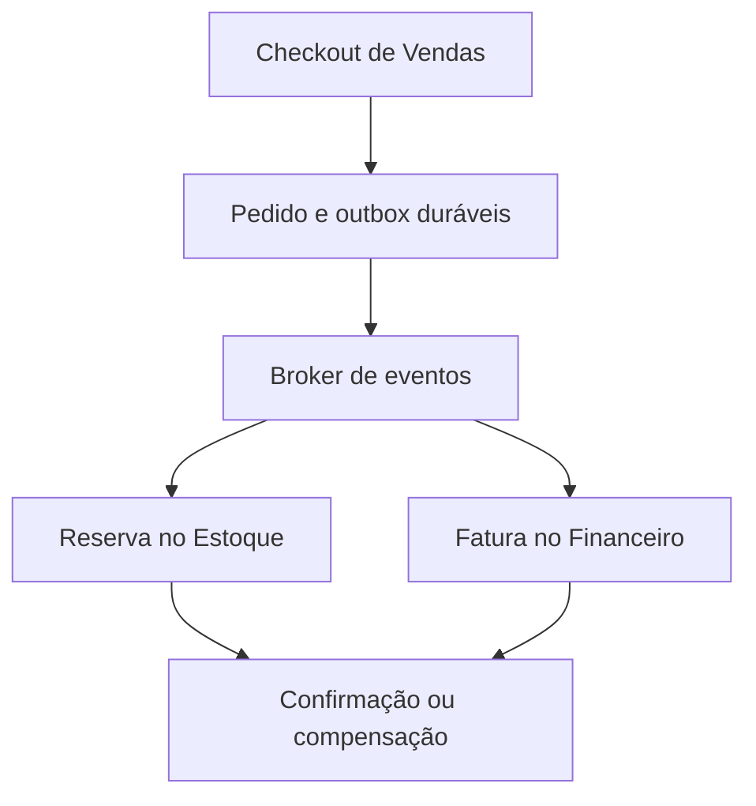

# Semana 13 — Contextos do ERP
Autor — João Pedro Costa de Abreu.

| Contexto | Entidades e responsabilidade | SGBD e motivo |
|---|---|---|
| Vendas | Carrinho, sessão e intenção de compra | Redis para acesso rápido e TTL da sessão |
| Estoque | Produto, atributos e saldo disponível | MongoDB para atributos heterogêneos e atualização atômica condicional |
| Financeiro | Fatura e conta | PostgreSQL para constraints, transações e relatórios consistentes |

## Execução
Execute `psql -f financeiro/faturas.sql`, `mongosh --file estoque/produtos.js` e `redis-cli < vendas/carrinho.redis` em bases didáticas. As duas faturas somam 400. O débito válido deixa saldo 60 na primeira execução. O débito inválido provoca erro de CHECK e o rollback preserva o saldo. Reexecutar o exemplo financeiro efetua outro débito válido enquanto houver saldo.

## Integração assíncrona
O checkout registra o pedido em armazenamento durável de Vendas e grava o evento PedidoCriado no outbox na mesma transação. Um publicador envia o evento para um broker. Estoque reserva unidades com atualização condicional e registra o identificador do evento processado. Financeiro cria a fatura com chave de idempotência por pedido. Os consumidores confirmam processamento após persistir o resultado. Eventos repetidos são ignorados por uma restrição única. Uma falha temporária gera tentativas limitadas e fila de mensagens não processadas. Falha definitiva de pagamento cancela o pedido e libera a reserva por compensação. O carrinho é apagado após confirmação durável. Redis é o armazenamento transitório demonstrado, e o registro durável do pedido é uma dependência da arquitetura real.

## Persistência poliglota
Persistência poliglota combina mecanismos de dados conforme acesso, consistência e estrutura. O catálogo variável se adapta a documentos, as faturas se beneficiam de integridade relacional e sessões usam cache. A contrapartida inclui operação de vários bancos, observabilidade, backups e consistência entre contextos. Uma equipe pequena pode começar com PostgreSQL e adicionar outros mecanismos quando os requisitos justificarem a complexidade.
